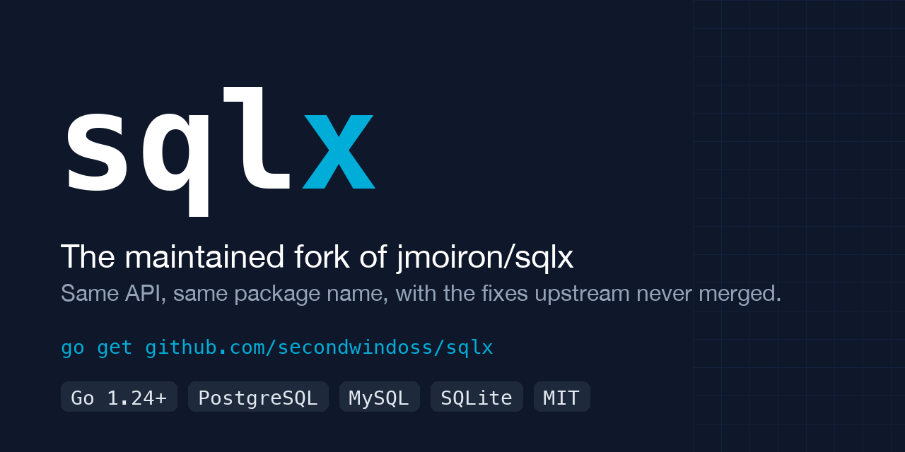

<p align="center">
  
</p>

<h3 align="center">
  <a href="https://pkg.go.dev/github.com/secondwindoss/sqlx">[Docs]</a> ·
  <a href="#quick-start">[Quick Start]</a> ·
  <a href="#migrating-from-jmoironsqlx">[Migration]</a> ·
  <a href="https://jmoiron.github.io/sqlx/">[User Guide]</a> ·
  <a href="CHANGELOG.md">[Changelog]</a>
</h3>

<p align="center">
  <a href="https://github.com/secondwindoss/sqlx/actions/workflows/ci.yml"></a>
  <a href="https://pkg.go.dev/github.com/secondwindoss/sqlx"></a>
  <a href="https://scorecard.dev/viewer/?uri=github.com/secondwindoss/sqlx"></a>
  <a href="go.mod"></a>
  <a href="https://github.com/secondwindoss/sqlx/releases"></a>
  <a href="LICENSE"></a>
</p>

sqlx is the maintained fork of [jmoiron/sqlx](https://github.com/jmoiron/sqlx).
It extends Go's standard `database/sql` package. Its `DB`, `Tx`, `Stmt` and
`Rows` types embed the standard ones, so every `database/sql` method still
works and the extensions sit next to them: scan rows into structs, maps and
slices, run named queries with `:name` parameters, expand slices with `In`,
and go from query to struct in one call with `Get` and `Select`.

## Why this fork

- **Drop-in.** Every exported identifier of upstream v1.4.0 is unchanged.
  CI runs `apidiff` against the v1.4.0 tag on every pull request to keep it
  that way. Migration is an import path change.
- **Fixed.** Named queries, `In` and `Rebind` now read SQL instead of counting
  bytes. A `?` or `:` inside a string literal, a quoted identifier or a comment
  is no longer mistaken for a parameter, and `now()::date` works as written.
  Twelve more upstream pull requests are merged with their original authors.
- **Maintained.** Every change runs the race tests on four Go versions against
  PostgreSQL 16, MySQL 8 and SQLite, plus `vet`, `staticcheck`, `goimports`
  and `govulncheck`.

|                    | jmoiron/sqlx                 | secondwindoss/sqlx                |
|--------------------|------------------------------|-----------------------------------|
| Last release       | v1.4.0, April 2024           | v1.4.1, October 2026              |
| Last commit        | May 2024                     | active                            |
| Open pull requests | 79 (October 2026)            | 0, the fixes are merged           |
| Go support         | `go 1.10`, untested          | Go 1.24 and newer, tested         |
| API                |                              | identical, checked by `apidiff`   |

## Quick start

    go get github.com/secondwindoss/sqlx@v1.4.1

sqlx requires Go 1.24 or newer.

> [!NOTE]
> Coming from `github.com/jmoiron/sqlx`? Only the import path changes. See
> [Migrating from jmoiron/sqlx](#migrating-from-jmoironsqlx).

```go
package main

import (
	"log"

	_ "github.com/lib/pq"
	"github.com/secondwindoss/sqlx"
)

type Person struct {
	ID        int    `db:"id"`
	FirstName string `db:"first_name"`
	Email     string // no tag: maps to the column "email"
}

func main() {
	// Connect opens the pool and pings it. Use sqlx.Open for sql.Open semantics.
	db, err := sqlx.Connect("postgres", "user=foo dbname=bar sslmode=disable")
	if err != nil {
		log.Fatalln(err)
	}

	// Named parameters come from the struct's db tags.
	_, err = db.NamedExec(`INSERT INTO person (first_name, email) VALUES (:first_name, :email)`,
		&Person{FirstName: "Jane", Email: "jane@example.com"})
	if err != nil {
		log.Fatalln(err)
	}

	// One row into a struct.
	var jane Person
	if err := db.Get(&jane, "SELECT * FROM person WHERE first_name = $1", "Jane"); err != nil {
		log.Fatalln(err)
	}

	// Many rows into a slice.
	var people []Person
	if err := db.Select(&people, "SELECT * FROM person ORDER BY id"); err != nil {
		log.Fatalln(err)
	}
	log.Printf("%+v, %d people", jane, len(people))
}
```

## Migrating from jmoiron/sqlx

Rewrite the import path, then update the dependency.

macOS:

    grep -rl 'github.com/jmoiron/sqlx' --include='*.go' . | xargs sed -i '' 's#github.com/jmoiron/sqlx#github.com/secondwindoss/sqlx#g'
    go get github.com/secondwindoss/sqlx@v1.4.1
    go mod tidy

Linux:

    grep -rl 'github.com/jmoiron/sqlx' --include='*.go' . | xargs sed -i 's#github.com/jmoiron/sqlx#github.com/secondwindoss/sqlx#g'
    go get github.com/secondwindoss/sqlx@v1.4.1
    go mod tidy

Tags up to v1.4.0 are upstream's and declare the upstream module path, so
v1.4.1 is the first version that resolves under the new path.

A `replace github.com/jmoiron/sqlx => github.com/secondwindoss/sqlx v1.4.1`
directive does not work: the fork imports its own `reflectx` package under
the new path, and Go refuses to use one module under two paths. Rewrite the
imports instead.

> [!IMPORTANT]
> Four documented behaviours changed in v1.4.1. Each one fixes a long-standing
> upstream issue, but check your queries for them:
>
> - `::` is a PostgreSQL cast and passes through untouched. The old escape that
>   turned `::` into `:` is gone, so a query that wrote `::::` now writes `::`.
> - `??` is a literal `?` in `In` and `Rebind`, so the PostgreSQL JSONB
>   operators `??`, `??|` and `??&` can be written as pgJDBC and squirrel do.
> - `In` expands an empty or nil slice to `NULL` instead of returning an error.
>   `x IN (NULL)` and `x NOT IN (NULL)` both match no row. Code that used the
>   error as an empty-list guard must check the length itself.
> - A parameter name cannot start with a digit, so `:1` is text.

## Features

**Scan into structs, with embedded structs.** Columns map to fields through
the `db` tag, or the lowercased field name when there is no tag.

```go
type Address struct {
	City    string
	Country string
}

type Person struct {
	FirstName string `db:"first_name"`
	Email     string
	Address   // embedded: city and country come from the same row
}

var p Person
err := db.Get(&p, "SELECT first_name, email, city, country FROM person WHERE id = $1", 1)

var people []Person
err = db.Select(&people, "SELECT first_name, email, city, country FROM person")
```

**Named queries** take a struct, a map, or a pointer to either. Prepared named
statements keep the parameter order for you.

```go
_, err := db.NamedExec(`INSERT INTO person (first_name, email) VALUES (:first_name, :email)`, p)

rows, err := db.NamedQuery(`SELECT * FROM person WHERE first_name = :first`,
	map[string]any{"first": "Jane"})
defer rows.Close()

stmt, err := db.PrepareNamed(`SELECT * FROM person WHERE email = :email`)
err = stmt.Get(&p, map[string]any{"email": "jane@example.com"})
```

**`In` and `Rebind`** expand a slice into a placeholder list and translate `?`
to the placeholder style of your driver. `In` always takes `?`, even on
PostgreSQL; `Rebind` turns it into `$1`.

```go
ids := []int{4, 8, 15}
query, args, err := sqlx.In("SELECT * FROM person WHERE id IN (?)", ids)
// query: SELECT * FROM person WHERE id IN (?, ?, ?)

query = db.Rebind(query) // $1, $2, $3 on PostgreSQL; ? stays ? on MySQL and SQLite
err = db.Select(&people, query, args...)
```

**Batch inserts** expand one `VALUES` group per element of a slice of structs
or maps.

```go
people := []Person{
	{FirstName: "Ardie", Email: "asavea@ab.co.nz"},
	{FirstName: "Ngani", Email: "nlaumape@ab.co.nz"},
}
_, err := db.NamedExec(`INSERT INTO person (first_name, email) VALUES (:first_name, :email)`, people)
```

**Transactions and prepared statements** have the same extensions as `DB`.

```go
tx := db.MustBegin()
tx.MustExec("INSERT INTO place (country, telcode) VALUES ($1, $2)", "Singapore", 65)
tx.NamedExec(`INSERT INTO place (country, telcode) VALUES (:country, :telcode)`,
	Place{Country: "Hong Kong", TelCode: 852})
if err := tx.Commit(); err != nil {
	log.Fatalln(err)
}

stmt, err := db.Preparex("SELECT * FROM place WHERE telcode = $1")
var place Place
err = stmt.Get(&place, 65)
```

**Row by row, maps and slices** when a struct is the wrong shape.

```go
rows, err := db.Queryx("SELECT * FROM place")
for rows.Next() {
	var place Place
	if err := rows.StructScan(&place); err != nil {
		log.Fatalln(err)
	}
}

row := map[string]any{}
err = db.QueryRowx("SELECT * FROM place WHERE telcode = $1", 65).MapScan(row)
```

Every method has a `Context` variant: `GetContext`, `SelectContext`,
`NamedExecContext`, `NamedQueryContext` and so on. The
[API reference](https://pkg.go.dev/github.com/secondwindoss/sqlx) lists them
all.

## What v1.4.1 fixes

| Before                                                                  | Now                                                        | Upstream                       |
|-------------------------------------------------------------------------|------------------------------------------------------------|--------------------------------|
| A `?` or `:` inside a string literal or a comment became a placeholder  | A SQL scanner skips literals, quoted identifiers, comments | [#984], [#151], [#768], [#474] |
| `now()::date` in a named query broke the cast                           | `::` is a cast and passes through                          | [#428], [#650], [#956]         |
| PostgreSQL `?` JSONB operators could not be used with `In` or `Rebind`  | `??` is a literal `?`                                      | [#628]                         |
| `In` with an empty slice returned an error                              | Expands to `NULL`, matches no row                          | [#945]                         |
| `In` panicked on a nil pointer that implements `driver.Valuer`          | Treated as `NULL`                                          | [#953]                         |
| Batch insert failed without a column list, in a `FROM`, or on a new line | All three forms expand                                    | [#962]                         |
| Named queries rejected a pointer to a slice or a map                    | Accepted                                                   | [#805]                         |
| A statement prepared on a `Conn` lost the `Conn`'s mapper               | Kept                                                       | [#993]                         |
| `Tx.Stmtx` dropped the transaction's `unsafe` flag                      | Kept                                                       | [#979]                         |
| `Rows.NextResultSet` panicked when the next set had other columns       | Field cache reset                                          | [#858]                         |
| `ConnectContext` leaked the pool when the ping failed                   | Closes it, like `Connect`                                  | [#561]                         |
| No `Tx.NamedQueryContext`                                               | Added                                                      | [#724]                         |

[CHANGELOG.md](CHANGELOG.md) lists every change with the fork pull request,
the upstream pull request and its author.

## Compatibility

**Go.** The two most recent Go releases are supported, as in the
[Go release policy](https://go.dev/doc/devel/release#policy). CI runs the race
tests on Go 1.24, 1.25, oldstable and stable.

**Databases.** CI tests every change against PostgreSQL 16, MySQL 8 and
SQLite. Any `database/sql` driver works; sqlx only needs to know its
placeholder style.

| Placeholder | Drivers                                                                   |
|-------------|---------------------------------------------------------------------------|
| `$1`        | `postgres`, `pgx`, `cockroach`, `pq-timeouts`, `cloudsqlpostgres`, `nrpostgres`, `ql` |
| `?`         | `mysql`, `sqlite3`, `nrmysql`, `nrsqlite3`                                 |
| `:name`     | `oci8`, `ora`, `goracle`, `godror`                                        |
| `@p1`       | `sqlserver`, `azuresql`                                                   |

Register any other driver at startup with `sqlx.BindDriver("mydriver", sqlx.DOLLAR)`.

## Known limitations

Row headers can be ambiguous (`SELECT 1 AS a, 2 AS a`), and `Columns()` does
not qualify column names in queries like:

```sql
SELECT a.id, a.name, b.id, b.name FROM foos AS a JOIN foos AS b ON a.parent = b.id;
```

making a struct or map destination ambiguous. Use `AS` to give columns
distinct names, `rows.Scan` to scan them manually, or `SliceScan` to get a
slice of results.

## Documentation

- [API reference](https://pkg.go.dev/github.com/secondwindoss/sqlx) on pkg.go.dev.
- Upstream's [user guide](https://jmoiron.github.io/sqlx/) explains how to use
  `database/sql` together with sqlx. Everything in it applies to the fork
  under the new import path.
- [CHANGELOG.md](CHANGELOG.md), [CONTRIBUTING.md](CONTRIBUTING.md) and
  [SECURITY.md](SECURITY.md).

## Project status and versioning

The fork follows [semantic versioning](https://semver.org). The v1 line keeps
the upstream API: `apidiff` runs against the v1.4.0 tag on every pull request
and fails on any incompatible change. A breaking change, such as removing a
deprecated API, gets a major version bump.

Upstream fixes are merged with their original commits, so each author keeps
the credit in the history and in the changelog. Bug reports and pull requests
are welcome in this repository; see [CONTRIBUTING.md](CONTRIBUTING.md).

## Credits and license

sqlx was created by [Jason Moiron](https://github.com/jmoiron) in 2013 and
maintained upstream until 2024. This fork keeps the full upstream history and
has been maintained by [secondwindoss](https://github.com/secondwindoss) since
2026. Licensed under the [MIT License](LICENSE).

## Full example

<details>
<summary>The complete walkthrough from the upstream README, updated for the fork</summary>

```go
package main

import (
    "database/sql"
    "fmt"
    "log"
    
    _ "github.com/lib/pq"
    "github.com/secondwindoss/sqlx"
)

var schema = `
CREATE TABLE person (
    first_name text,
    last_name text,
    email text
);

CREATE TABLE place (
    country text,
    city text NULL,
    telcode integer
)`

type Person struct {
    FirstName string `db:"first_name"`
    LastName  string `db:"last_name"`
    Email     string
}

type Place struct {
    Country string
    City    sql.NullString
    TelCode int
}

func main() {
    // this Pings the database trying to connect
    // use sqlx.Open() for sql.Open() semantics
    db, err := sqlx.Connect("postgres", "user=foo dbname=bar sslmode=disable")
    if err != nil {
        log.Fatalln(err)
    }

    // exec the schema or fail; multi-statement Exec behavior varies between
    // database drivers;  pq will exec them all, sqlite3 won't, ymmv
    db.MustExec(schema)
    
    tx := db.MustBegin()
    tx.MustExec("INSERT INTO person (first_name, last_name, email) VALUES ($1, $2, $3)", "Jason", "Moiron", "jmoiron@jmoiron.net")
    tx.MustExec("INSERT INTO person (first_name, last_name, email) VALUES ($1, $2, $3)", "John", "Doe", "johndoeDNE@gmail.net")
    tx.MustExec("INSERT INTO place (country, city, telcode) VALUES ($1, $2, $3)", "United States", "New York", "1")
    tx.MustExec("INSERT INTO place (country, telcode) VALUES ($1, $2)", "Hong Kong", "852")
    tx.MustExec("INSERT INTO place (country, telcode) VALUES ($1, $2)", "Singapore", "65")
    // Named queries can use structs, so if you have an existing struct (i.e. person := &Person{}) that you have populated, you can pass it in as &person
    tx.NamedExec("INSERT INTO person (first_name, last_name, email) VALUES (:first_name, :last_name, :email)", &Person{"Jane", "Citizen", "jane.citzen@example.com"})
    tx.Commit()

    // Query the database, storing results in a []Person (wrapped in []interface{})
    people := []Person{}
    db.Select(&people, "SELECT * FROM person ORDER BY first_name ASC")
    jason, john := people[1], people[2]

    fmt.Printf("%#v\n%#v\n", jason, john)
    // Person{FirstName:"Jason", LastName:"Moiron", Email:"jmoiron@jmoiron.net"}
    // Person{FirstName:"John", LastName:"Doe", Email:"johndoeDNE@gmail.net"}

    // You can also get a single result, a la QueryRow
    jason = Person{}
    err = db.Get(&jason, "SELECT * FROM person WHERE first_name=$1", "Jason")
    fmt.Printf("%#v\n", jason)
    // Person{FirstName:"Jason", LastName:"Moiron", Email:"jmoiron@jmoiron.net"}

    // if you have null fields and use SELECT *, you must use sql.Null* in your struct
    places := []Place{}
    err = db.Select(&places, "SELECT * FROM place ORDER BY telcode ASC")
    if err != nil {
        fmt.Println(err)
        return
    }
    usa, singsing, honkers := places[0], places[1], places[2]
    
    fmt.Printf("%#v\n%#v\n%#v\n", usa, singsing, honkers)
    // Place{Country:"United States", City:sql.NullString{String:"New York", Valid:true}, TelCode:1}
    // Place{Country:"Singapore", City:sql.NullString{String:"", Valid:false}, TelCode:65}
    // Place{Country:"Hong Kong", City:sql.NullString{String:"", Valid:false}, TelCode:852}

    // Loop through rows using only one struct
    place := Place{}
    rows, err := db.Queryx("SELECT * FROM place")
    for rows.Next() {
        err := rows.StructScan(&place)
        if err != nil {
            log.Fatalln(err)
        } 
        fmt.Printf("%#v\n", place)
    }
    // Place{Country:"United States", City:sql.NullString{String:"New York", Valid:true}, TelCode:1}
    // Place{Country:"Hong Kong", City:sql.NullString{String:"", Valid:false}, TelCode:852}
    // Place{Country:"Singapore", City:sql.NullString{String:"", Valid:false}, TelCode:65}

    // Named queries, using `:name` as the bindvar.  Automatic bindvar support
    // which takes into account the dbtype based on the driverName on sqlx.Open/Connect
    _, err = db.NamedExec(`INSERT INTO person (first_name,last_name,email) VALUES (:first,:last,:email)`, 
        map[string]interface{}{
            "first": "Bin",
            "last": "Smuth",
            "email": "bensmith@allblacks.nz",
    })

    // Selects Mr. Smith from the database
    rows, err = db.NamedQuery(`SELECT * FROM person WHERE first_name=:fn`, map[string]interface{}{"fn": "Bin"})

    // Named queries can also use structs.  Their bind names follow the same rules
    // as the name -> db mapping, so struct fields are lowercased and the `db` tag
    // is taken into consideration.
    rows, err = db.NamedQuery(`SELECT * FROM person WHERE first_name=:first_name`, jason)
    
    
    // batch insert
    
    // batch insert with structs
    personStructs := []Person{
        {FirstName: "Ardie", LastName: "Savea", Email: "asavea@ab.co.nz"},
        {FirstName: "Sonny Bill", LastName: "Williams", Email: "sbw@ab.co.nz"},
        {FirstName: "Ngani", LastName: "Laumape", Email: "nlaumape@ab.co.nz"},
    }

    _, err = db.NamedExec(`INSERT INTO person (first_name, last_name, email)
        VALUES (:first_name, :last_name, :email)`, personStructs)

    // batch insert with maps
    personMaps := []map[string]interface{}{
        {"first_name": "Ardie", "last_name": "Savea", "email": "asavea@ab.co.nz"},
        {"first_name": "Sonny Bill", "last_name": "Williams", "email": "sbw@ab.co.nz"},
        {"first_name": "Ngani", "last_name": "Laumape", "email": "nlaumape@ab.co.nz"},
    }

    _, err = db.NamedExec(`INSERT INTO person (first_name, last_name, email)
        VALUES (:first_name, :last_name, :email)`, personMaps)
}
```

</details>

[#151]: https://github.com/jmoiron/sqlx/pull/151
[#428]: https://github.com/jmoiron/sqlx/issues/428
[#474]: https://github.com/jmoiron/sqlx/pull/474
[#561]: https://github.com/jmoiron/sqlx/pull/561
[#628]: https://github.com/jmoiron/sqlx/issues/628
[#650]: https://github.com/jmoiron/sqlx/issues/650
[#724]: https://github.com/jmoiron/sqlx/pull/724
[#768]: https://github.com/jmoiron/sqlx/pull/768
[#805]: https://github.com/jmoiron/sqlx/pull/805
[#858]: https://github.com/jmoiron/sqlx/pull/858
[#945]: https://github.com/jmoiron/sqlx/pull/945
[#953]: https://github.com/jmoiron/sqlx/pull/953
[#956]: https://github.com/jmoiron/sqlx/issues/956
[#962]: https://github.com/jmoiron/sqlx/pull/962
[#979]: https://github.com/jmoiron/sqlx/pull/979
[#984]: https://github.com/jmoiron/sqlx/pull/984
[#993]: https://github.com/jmoiron/sqlx/pull/993
